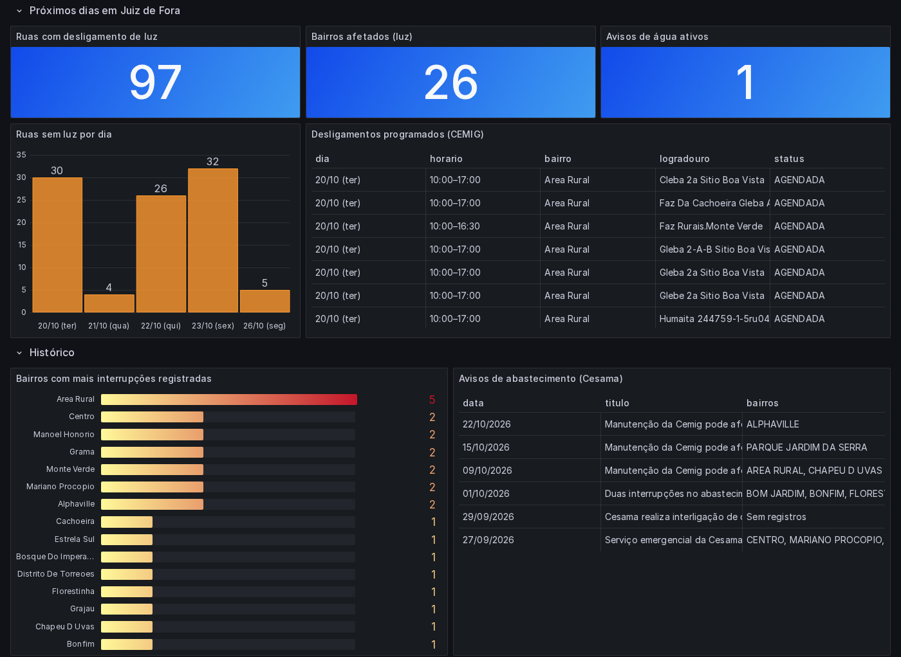

# Monitor de luz e água — Juiz de Fora

Avisa no Telegram quando a **CEMIG** programa um desligamento de energia ou quando a **Cesama** anuncia uma interrupção no abastecimento de água nos seus endereços. Também guarda o histórico que as duas empresas não guardam.

**Pergunta:** vai faltar luz ou água em casa nos próximos dias? E quais bairros de Juiz de Fora mais ficam sem esses serviços?



*Só os painéis da cidade, com dados que a CEMIG e a Cesama publicam. Os painéis "Meus locais" e "Alertas enviados" ficam de fora da imagem porque mostram os endereços monitorados.*

## Arquitetura

```
API da CEMIG (JSON) ─────┐                                   ┌─► Telegram
 373 bairros de JF       │                                   │   "⏰ AMANHÃ: 10:00–17:00 Rua X"
                         ├─► coletor (07h e 19h) ─► Postgres ┤
Site da Cesama (HTML) ───┘    │  raw.*                       └─► Grafana (:3000)
 notícias de abastecimento    │                                   meus locais, cidade, histórico,
                              ▼                                   saúde da coleta
                         dbt build
                         staging ─► marts (interrupções, ranking de bairros, saúde da coleta)
```

## Fontes

| Fonte | Como é coletada | Granularidade |
|---|---|---|
| CEMIG | API JSON pública que alimenta a página "Desligamento programado" | data, horário, rua e números das casas |
| Cesama | Notícias do site filtradas por "abastecimento" | data e bairros, extraídos do texto livre |

## Decisões técnicas

- **Dados pessoais:** a API da CEMIG devolve o número da instalação de cada casa. Esse campo é descartado na coleta e nunca é gravado. O endereço do usuário fica em `config.toml`, que não entra no git.
- **Histórico próprio:** a CEMIG só mostra os próximos dias. O banco grava quando cada desligamento apareceu pela primeira vez (`primeiro_visto`), o que também permite medir com quantos dias de antecedência ele é avisado.
- **Extração de texto da Cesama:** a data do evento vem do texto ("nesta quinta-feira, 1º" vira 01/10), e os bairros são procurados no texto usando como dicionário a lista oficial de bairros da CEMIG.
  - Na primeira versão, o rodapé do site, com links para a "Represa de São Pedro" e a "Represa Dr. João Penido", fazia todo aviso conter São Pedro e Penido. Agora a extração lê só o `<article>`.
  - "Região Centro" não conta como o bairro Centro.
- **Alertas sem repetição:** cada desligamento gera no máximo um aviso de "novo", um de "amanhã" e um de "cancelado". Ruas do mesmo dia vão juntas numa única mensagem.
- **Monitoramento do próprio robô:** cada coleta é registrada em `raw.execucoes`. Se a API mudar de formato ou devolver menos bairros do que o esperado, chega um alerta de falha. `marts.fct_saude_coleta` marca uma fonte como atrasada depois de 24h sem sucesso.

- **Grafana provisionado como código:** a fonte de dados e o painel ficam versionados em `grafana/`. O JSON do painel é gerado por `grafana/gerar_dashboard.py`, para não editar à mão 17 painéis de JSON. O `docker compose up` já sobe tudo pronto, sem nenhum clique.
- **Locais no banco:** o coletor grava o `config.toml` em `raw.locais`, e o modelo `marts.fct_meus_locais` cruza seus endereços com os desligamentos. Assim a mesma regra serve o painel e pode ser testada pelo dbt.

## Como rodar

```bash
make up         # cria config.toml e .env a partir dos exemplos e sobe tudo
```

1. Em `config.toml`, coloque seus locais. Pode ser só o bairro ou rua + número, escritos como na conta de luz.
2. Para receber no Telegram, crie um bot com o @BotFather e preencha `TELEGRAM_TOKEN` e `TELEGRAM_CHAT_ID` no `.env`. Sem isso, os alertas aparecem só no log e no dashboard.
3. O painel do Grafana fica em http://localhost:3000. Ele abre sem login, em modo leitura. Para editar, entre como `admin` com a senha `admin` ou a definida em `GRAFANA_SENHA`.

`make testes` roda os testes de extração de datas e bairros e de correspondência de endereço. `make logs` acompanha a coleta.

O GitHub Actions roda, a cada push, os testes de extração, o `dbt parse` e confere se o JSON do painel versionado é o mesmo que `grafana/gerar_dashboard.py` produz. O coletor não roda no CI, para não chamar a API da CEMIG a cada push.
